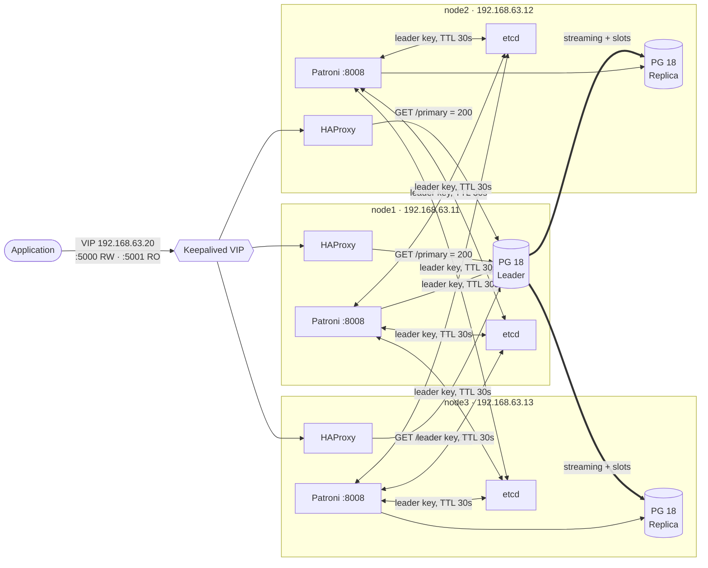

# postgres-patroni-ha

**3-node PostgreSQL 18** cluster with **automatic failover**: **Patroni** manages Postgres and
elects the leader, **etcd** (3 members) is the consensus store, **HAProxy** on every node routes
writes to the leader and reads to replicas, **Keepalived** gives clients one VIP.

This is the "automatic" big brother of
[postgres-2node-pgbouncer](https://github.com/bomtan2000/postgres-2node-pgbouncer), which uses
manual failover because 2 nodes cannot form a quorum.

## Architecture



Packet path for a write: client → VIP `:5000` (held by whichever node has a live HAProxy) →
HAProxy asks every Patroni `GET /primary` every 3 s → only the leader answers 200 → TCP to
`leader:5432`. The VIP does **not** need to follow the Postgres leader: every HAProxy finds the
leader on its own.

| Component | Version | Runs on |
|---|---|---|
| OS | Oracle Linux / RHEL 9 | all 3 |
| PostgreSQL | 18 (Percona Distribution, `ppg18`) | all 3 |
| Patroni | `percona-patroni` (4.x) | all 3 |
| etcd | 3.5 (Percona repo) | all 3 |
| HAProxy, Keepalived | `percona-haproxy`, OS keepalived | all 3 |

## Ports

| Port | Service | Who connects |
|---|---|---|
| 5000 | HAProxy → leader (read/write) | Applications via VIP |
| 5001 | HAProxy → replicas, round robin (read only) | Applications via VIP |
| 7000 | HAProxy stats page | Ops |
| 5432 | PostgreSQL | HAProxy, replication, `pg_rewind` |
| 8008 | Patroni REST API (`/primary`, `/replica`, `/health`) | HAProxy health checks, `patronictl` |
| 2379 | etcd client | Patroni, `etcdctl` |
| 2380 | etcd peer | etcd ↔ etcd |
| VRRP (proto 112) | Keepalived | node ↔ node |

## Layout

```
config/hosts                     /etc/hosts block for the 3 nodes
config/etcd/nodeN.conf.yaml      /etc/etcd/etcd.conf.yaml per node (node1 = new, others = existing)
config/patroni/nodeN.yml         /etc/patroni/patroni.yml per node
config/haproxy/haproxy.cfg       identical on the 3 nodes
config/keepalived/nodeN.conf     MASTER 100 / BACKUP 90 / BACKUP 80, tracks HAProxy
runbooks/install.md              step by step, in dependency order
runbooks/failover-test.md        replication test, kill the leader, rejoin
runbooks/operations.md           switchover, edit-config, pause, reinit, etcd health
```

Each file holds its values in place: one file per node instead of templates, so what you read is
exactly what runs on that node.

## How to run

Follow [runbooks/install.md](runbooks/install.md): hosts + firewall → packages → etcd (node1
creates, node2/node3 join) → Patroni (node1 first) → HAProxy → Keepalived.

## How to verify

```bash
patronictl -c /etc/patroni/patroni.yml list                 # 1 Leader, 2 Replica streaming, Lag 0
curl -s -o /dev/null -w '%{http_code}\n' http://node1:8008/primary   # 200 on the leader only
curl -s -o /dev/null -w '%{http_code}\n' http://node2:8008/replica   # 200 on replicas only
etcdctl --endpoints=http://node1:2379,http://node2:2379,http://node3:2379 endpoint health
psql -h 192.168.63.20 -p 5000 -U postgres -c "select pg_is_in_recovery();"   # f
psql -h 192.168.63.20 -p 5001 -U postgres -c "select pg_is_in_recovery();"   # t
```

Then run the [failover test](runbooks/failover-test.md).

## Design decisions

| Decision | Why |
|---|---|
| 3 nodes, etcd on each | etcd needs a majority: 3 members survive 1 failure. 2 members survive none. This is what makes automatic failover safe where the 2-node setup is not. |
| Patroni holds a leader **key with TTL** in etcd | A leader that cannot renew the key (crash, network cut, no etcd quorum) loses it after 30 s **and demotes itself**. Two primaries would need two keys, and etcd will not hand out two. |
| Every Patroni lists **all 3** etcd endpoints | With only the local etcd, losing that etcd process alone would make the node drop out of the cluster. |
| `maximum_lag_on_failover: 1 MB` | A replica that is far behind is never promoted, so a failover cannot silently drop a large chunk of commits. |
| `failover_priority` 3 / 2 / 1 | Among equally caught-up replicas the election is predictable (node2 before node3). |
| `use_slots: true` + `wal_keep_size: 160MB` | The leader keeps WAL until every replica has it, so replicas never need a full rebuild after a short outage. |
| `use_pg_rewind` + `wal_log_hints` + data checksums | The old leader rejoins by rewinding the few diverged blocks instead of a full `pg_basebackup`. |
| HAProxy on every node, health check = Patroni REST API | Routing follows Patroni's view of the leader, the only authoritative one. `on-marked-down shutdown-sessions` cuts sessions to a demoted leader immediately. |
| Separate RW (5000) and RO (5001) ports | Read scaling stays explicit in the app. A transparent read/write splitter has to parse SQL, which breaks on functions that write. |
| Keepalived tracks **HAProxy**, not the Postgres role | The VIP only has to land on a working HAProxy. Patroni and Keepalived never have to agree, so there is no race between them. |
| Patroni starts Postgres. `postgresql-18.service` stays disabled | One owner for the data directory. A second manager restarting Postgres behind Patroni's back is a classic split-brain cause. |
| Async replication (no `synchronous_mode`) | Writes never block on a replica. Cost: RPO > 0 (see below). |
| scram-sha-256 everywhere, pg_hba limited to the lab subnet | MD5 is deprecated in PG 18. The original guide allowed `0.0.0.0/0`. |

### Failover timing and data loss

- **Detection**: the leader key expires within `ttl` (30 s). Replicas check every `loop_wait` (10 s).
- **Promotion + routing**: a few seconds for promote, then HAProxy needs `rise 2 × inter 3s`.
- Expected write outage on a hard crash: roughly **30-40 s**. A planned `patronictl switchover` takes a few seconds.
- **RPO**: replication is async. Commits on the old leader that were not yet streamed are lost.
  At most `maximum_lag_on_failover` (1 MB of WAL). If the only candidate is further behind,
  Patroni promotes **nobody** and waits. Set `synchronous_mode: true` for RPO = 0, at the cost of
  write latency, and writes stop if no sync replica is available.

## Troubleshooting

| Symptom | Likely cause | Check / fix |
|---|---|---|
| `patronictl list` shows no Leader | etcd has no quorum, or every candidate is beyond `maximum_lag_on_failover` | `etcdctl ... endpoint health`. `journalctl -u patroni`. |
| Leader turns read-only by itself | It could not renew the key: etcd quorum lost or network cut from etcd | Fix etcd first. This is Patroni preventing split-brain, not a bug. |
| `etcdctl member list` hangs / errors | Using port 2380 (peer) instead of 2379 (client) | `--endpoints=http://node1:2379` |
| New etcd member will not start: `member ... has already been bootstrapped` | `initial-cluster-state` / `member add` order wrong, stale `/var/lib/etcd` | `etcdctl member remove`, wipe its data dir, `member add`, start again |
| HAProxy `primary` shows 0 servers UP | Patroni API not reachable on 8008 (firewall, SELinux) | `curl http://nodeX:8008/primary`. `setsebool -P haproxy_connect_any on` |
| Replica stuck `starting` / `start failed` | pg_hba rejects replication from its subnet, or slot missing | `journalctl -u patroni`, `pctl reinit pg-cluster nodeX` |
| Old leader does not rejoin | `pg_rewind` failed (checksums/`wal_log_hints` off, or WAL gone) | `pctl reinit pg-cluster nodeX` (full basebackup) |
| `Pending restart` after a config change | Parameter needs a restart | `pctl restart pg-cluster --pending` |
| VIP on two nodes | VRRP blocked between nodes | `tcpdump -ni ens160 vrrp`, firewall rich rule for vrrp |

## What changed vs. the original hands-on guide

The repo is built from a PostgreSQL 14 install guide I followed. Moving it to a repo I changed:

| Original | Here | Why |
|---|---|---|
| PostgreSQL 14 (`ppg14`) | PostgreSQL 18 (`ppg18`) | PG 14 reached end of life on 2026-11-12 |
| `etcdctl --endpoints=http://node1:2380` | `:2379` | 2380 is the peer port |
| `etcd3.host:` own node only | `etcd3.hosts:` all 3 | local etcd was a single point of failure for that node |
| `wal_keep_segments: 10` | `wal_keep_size: 160MB` | parameter removed in PG 13 |
| `bootstrap.users` | `CREATE ROLE` after bootstrap | removed in Patroni 4 |
| pg_hba `0.0.0.0/0 md5`, replication `trust` | lab subnet, `scram-sha-256`, local lines added | least privilege. Patroni connects via 127.0.0.1 |
| Keepalived without health check | `chk_haproxy`, weight -30 | a dead HAProxy used to keep the VIP |
| Replication test read `node3:5000` | `node3:5432` / VIP `:5001` | `:5000` routes back to the leader |
| Pgpool-II alternative | not included | HAProxy + Patroni REST is the simpler, single-source-of-truth design |

**Not yet re-run end to end on PostgreSQL 18.** The original steps were run on PG 14.

## Next steps

- `failsafe_mode: true`: keep the leader writable during a short etcd outage, as long as it can reach every member.
- Patroni watchdog (`/dev/watchdog`): if Patroni hangs while Postgres keeps running, the node reboots instead of staying a zombie primary.
- etcd TLS + auth, and Patroni REST API auth (anyone on the subnet can call `/switchover`).
- Dedicated etcd nodes (or a 5-member etcd) for bigger clusters.
- pgBackRest with WAL archiving to object storage. The local `cp` archive is not a backup.
- PgBouncer in front of HAProxy for connection pooling (as in the [2-node repo](https://github.com/bomtan2000/postgres-2node-pgbouncer)).
- HAProxy stats page auth (`stats auth`).

## License

[MIT](LICENSE)
